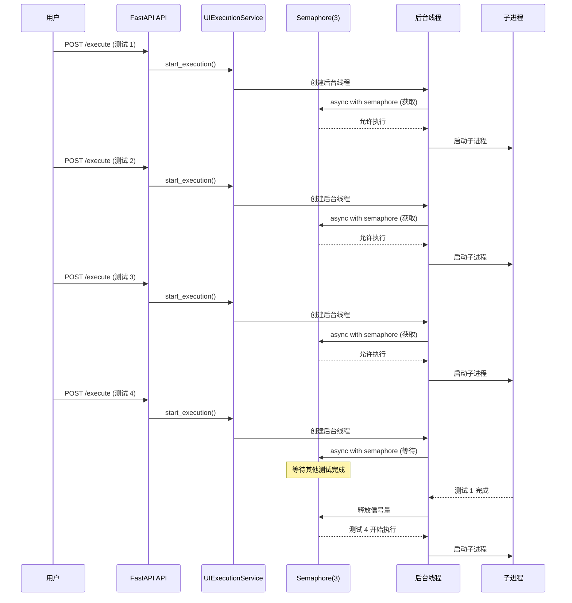

# 第10 篇：Python 协程实战：asyncio 在测试系统中的并发控制与异步编程
> **代码说明**：本文中的代码示例来自完整版系统，配套代码（`配套代码/` 目录）提供了功能一致的简化版——去掉了 LLM API、LangGraph、数据库等外部依赖，替换为纯规则实现 + JSON 文件 + 内置演示应用。文章讲原理，配套代码可本地跑通，两相对照效果更好。

文中用于演示「网络 I/O 等待」的 URL 默认指向本地服务（`http://127.0.0.1:5000`，内置 `demo_app` 时在 `demo_app/` 下 `python app.py`）；并行探测示例使用真实存在的 GET 路径（如 `/api/products`）。协程语法与事件循环规则不依赖具体业务，可与 `API_BASE_URL`、`配套代码/tests/`（如 `test_mcp_and_async.py`）联调环境对照。

## 大纲

- 为什么需要协程？从阻塞到并发的演进
- asyncio 核心概念：事件循环、协程、Task、Future
- 项目实战：asyncio.Semaphore 控制浏览器并发
- 项目实战：asyncio.gather 并行执行多任务
- 协程与线程的混用：跨事件循环的正确姿势
- 常见陷阱：RuntimeError、死锁、内存泄漏
- 总结

---

## 一、从阻塞到并发

### 1.1 同步版本的痛点

在第 7 篇中我们讨论了为什么需要并发控制——10 个浏览器实例同时启动，内存直接 OOM。但并发控制的**实现方式**决定了系统的上限。先看同步版本的限制：

```python
# 同步版本：阻塞、串行、慢
def run_ui_tests(tests):

    results = []
    for test in tests:
        # 每个测试启动一个浏览器，等待完成
        result = launch_browser(test)  # 阻塞 30-60 秒
        results.append(result)
    return results

# 问题：
# 1. 10 个测试 × 30 秒 = 5 分钟（串行）
# 2. 10 个浏览器同时运行 → 内存爆炸（10 × 300MB = 3GB）
# 3. 无法控制并发数
```

**异步版本**解决了所有问题：

```python
# 异步版本：非阻塞、并发、可控
async def run_ui_tests(tests, max_concurrent=3):
    semaphore = asyncio.Semaphore(max_concurrent)  # 最多 3 个并发
    tasks = [run_single_test(test, semaphore) for test in tests]
    results = await asyncio.gather(*tasks)
    return results

# 优势：
# 1. 10 个测试 / 3 并发 ≈ 2 分钟（并发）
# 2. 最多 3 个浏览器同时运行 → 内存可控（3 × 300MB = 900MB）
# 3. 并发数可配置
```

### 1.2 为什么选 asyncio？

我们的测试系统是典型的 **I/O 密集型**场景——等待网络响应、等待浏览器渲染、等待子进程完成。这些等待时间占据了 90% 以上的执行时间。

asyncio 的价值不在于"更快"，而在于**让等待时间可以被利用**。当浏览器 A 在等待页面加载时，事件循环可以去启动浏览器 B 的操作。配合 `asyncio.Semaphore` 控制并发数，既能充分利用资源，又不会让内存爆炸。

> 第 7 篇已详细讨论过 Semaphore 的原理和进程隔离设计，本篇聚焦 asyncio 的进阶用法：gather、Task 管理、跨事件循环、以及常见陷阱。

---

## 二、asyncio 核心概念

### 2.1 事件循环 (Event Loop)

事件循环是 asyncio 的**心脏**，它负责：
1. 注册和调度协程
2. 执行 I/O 操作
3. 在 I/O 等待时切换协程

```python
import asyncio

async def main():
    print("开始")
    await asyncio.sleep(1)  # 模拟 I/O 等待
    print("结束")

# 方式 1：直接运行（Python 3.7+）
asyncio.run(main())

# 方式 2：手动获取事件循环（旧版本）
loop = asyncio.get_event_loop()
loop.run_until_complete(main())
```

**关键规则**：
- 每个线程有**一个**事件循环
- `asyncio.run()` 会创建新的事件循环
- 在已有事件循环的线程中调用 `asyncio.run()` 会报错

### 2.2 协程 (Coroutine)

协程是用 `async def` 定义的函数，调用它**不会立即执行**，而是返回一个协程对象：

```python
async def fetch_data(url):
    await asyncio.sleep(1)  # 模拟网络请求
    return f"Data from {url}"

# 调用协程函数，返回协程对象（不执行）
coro = fetch_data("http://127.0.0.1:5000/api/products")
print(type(coro))  # <class 'coroutine'>

# 必须用 await 或 asyncio.run() 执行
result = await coro  # 在 async 函数中
# 或
result = asyncio.run(coro)  # 在顶层
```

### 2.3 Task 和 Future

**Task** 是协程的"包装器"，让协程可以**并发执行**：

```python
async def main():
    BASE = "http://127.0.0.1:5000"
    # 创建 Task（立即调度执行）
    task1 = asyncio.create_task(fetch_data(f"{BASE}/api/products"))
    task2 = asyncio.create_task(fetch_data(f"{BASE}/api/seckill/list"))
    
    # 等待两个 Task 完成
    result1 = await task1
    result2 = await task2
    
    return [result1, result2]
```

**Future** 是 Task 的基类，代表"未来的结果"：

```python
async def main():
    loop = asyncio.get_event_loop()
    
    # 创建 Future
    future = loop.create_future()
    
    # 在某个时刻设置结果
    asyncio.create_task(set_result(future))
    
    # 等待 Future 完成
    result = await future
    return result

async def set_result(future):
    await asyncio.sleep(1)
    future.set_result("Done!")
```

### 2.4 await 的本质

`await` 不是阻塞，而是**让出控制权**：

```python
async def example():
    print("1. 开始等待")
    await asyncio.sleep(2)  # 让出控制权，2 秒后恢复
    print("3. 恢复执行")

# 执行流程：
# 1. 打印 "1. 开始等待"
# 2. await 让出控制权，事件循环执行其他任务
# 3. 2 秒后，事件循环恢复这个协程
# 4. 打印 "3. 恢复执行"
```

---

## 三、项目实战：asyncio.Semaphore 控制浏览器并发

### 3.1 问题背景

在 UI 测试系统中，我们允许用户同时执行多个测试脚本。但浏览器非常消耗资源：
- 每个浏览器实例占用 ~300MB 内存
- 每个浏览器实例占用 ~1 个 CPU 核心
- 同时运行太多浏览器会导致系统崩溃

**解决方案**：使用 `asyncio.Semaphore` 限制并发数。

### 3.2 Semaphore 的工作原理

```python
import asyncio

async def worker(semaphore, worker_id):
    async with semaphore:  # 获取信号量
        print(f"Worker {worker_id} 开始执行")
        await asyncio.sleep(2)  # 模拟工作
        print(f"Worker {worker_id} 完成")

async def main():
    # 最多 3 个并发
    semaphore = asyncio.Semaphore(3)
    
    # 启动 10 个 worker
    tasks = [worker(semaphore, i) for i in range(10)]
    await asyncio.gather(*tasks)

asyncio.run(main())

# 输出：
# Worker 0 开始执行
# Worker 1 开始执行
# Worker 2 开始执行
# (等待 2 秒)
# Worker 0 完成
# Worker 3 开始执行  ← 只有 0 完成后，3 才能开始
# Worker 1 完成
# Worker 4 开始执行
# Worker 2 完成
# Worker 5 开始执行
# ...
```

### 3.3 项目中的实现

在我们的 UI 执行服务中，Semaphore 的实际使用如下（配套代码 `worker/execution_service.py`）：

```python
class UIExecutionService:
    def __init__(self, max_concurrent: int = 4):
        self._sem = asyncio.Semaphore(max_concurrent)  # 直接初始化，不用懒加载
        self._active: Dict[str, asyncio.Task] = {}
    
    async def execute(self, config: Dict) -> Dict:
        eid = config.get("exec_id") or str(uuid.uuid4())[:8]
        async def _run(): return await self._exec(config, eid)
        t = asyncio.create_task(_run())
        self._active[eid] = t
        try: return await t
        finally: self._active.pop(eid, None)
    
    async def _exec(self, config, eid):
        async with self._sem:  # ← 核心：等待信号量
            # 写入配置文件
            json.dump(config, open(p["config"], "w"), ensure_ascii=False, indent=2)
            
            # 启动子进程（异步非阻塞）
            proc = await asyncio.create_subprocess_exec(
                sys.executable, ws, p["config"], p["result"], p["stop"],
                stdout=asyncio.subprocess.PIPE,
                stderr=asyncio.subprocess.PIPE
            )
            
            # 等待完成（带超时）
            try:
                stdout, stderr = await asyncio.wait_for(
                    proc.communicate(),
                    timeout=float(config.get("timeout", 300))
                )
            except asyncio.TimeoutError:
                proc.kill()
                result = {"exec_id": eid, "status": "timeout"}
            
            # 读取结果
            if os.path.exists(p["result"]):
                result = json.load(open(p["result"]))
            return result if result else {"exec_id": eid, "status": "unknown"}
```

**关键设计**：
1. **直接初始化 Semaphore**：不用懒加载 property，避免并发创建问题
2. **`asyncio.create_subprocess_exec` 而非 `subprocess.Popen`**：在 async 函数中用同步 `Popen + wait()` 会阻塞事件循环，这是常见陷阱
3. **`asyncio.wait_for` 控制超时**：比 `proc.wait(timeout=)` 更可靠，超时后直接 kill
4. **`asyncio.create_task` 管理活跃任务**：支持 `stop_all()` 批量停止

### 3.4 并发控制的完整流程



---

## 四、项目实战：asyncio.gather 并行执行多任务

### 4.1 gather 的基本用法

`asyncio.gather()` 用于**并行执行多个协程**，并等待所有完成：

```python
async def fetch(url):
    await asyncio.sleep(1)  # 模拟网络请求
    return f"Data from {url}"

async def main():
    BASE = "http://127.0.0.1:5000"
    urls = [
        f"{BASE}/api/products",
        f"{BASE}/api/seckill/list",
        f"{BASE}/api/seckill/activities",
        f"{BASE}/api-docs",
        f"{BASE}/login",
    ]
    
    # 并行执行 5 个请求
    results = await asyncio.gather(
        *[fetch(url) for url in urls]
    )
    
    print(results)
    # 每个元素形如 'Data from http://127.0.0.1:5000/api/products' ...

asyncio.run(main())
```

### 4.2 gather 的错误处理

默认情况下，一个协程失败会导致整个 gather 失败：

```python
async def fetch(url):
    if "seckill/list" in url:
        raise Exception("Network error")
    await asyncio.sleep(1)
    return f"Data from {url}"

async def main():
    BASE = "http://127.0.0.1:5000"
    urls = [
        f"{BASE}/api/products",
        f"{BASE}/api/seckill/list",
        f"{BASE}/api/seckill/activities",
        f"{BASE}/api-docs",
    ]
    
    # 方式 1：默认行为（一个失败，全部失败）
    try:
        results = await asyncio.gather(
            *[fetch(url) for url in urls]
        )
    except Exception as e:
        print(f"失败：{e}")  # 打印 "失败：Network error"
    
    # 方式 2：return_exceptions=True（返回异常对象）
    results = await asyncio.gather(
        *[fetch(url) for url in urls],
        return_exceptions=True
    )
    print(results)
    # ['Data from http://127.0.0.1:5000/api/products',
    #  Exception('Network error'),
    #  'Data from http://127.0.0.1:5000/api/seckill/activities',
    #  'Data from http://127.0.0.1:5000/api-docs']

asyncio.run(main())
```

### 4.3 项目中的 gather 应用

在我们的 Dashboard 服务器中，使用 gather 广播消息：

```python
class TestDashboardServer:
    async def broadcast(self, message: dict):
        """广播消息到所有客户端"""
        if connected_clients:
            # 异步发送所有消息
            await asyncio.gather(
                *[client.send(json.dumps(message, ensure_ascii=False)) 
                  for client in connected_clients],
                return_exceptions=True  # ← 关键：某个客户端失败不影响其他
            )
```

**为什么用 return_exceptions=True？**
- 某个客户端断开连接会导致 `send()` 失败
- 如果不捕获异常，整个广播会失败
- 用 `return_exceptions=True`，失败的客户端会被忽略，其他客户端正常接收

---

## 五、协程与线程的混用

### 5.1 为什么需要混用？

在我们的项目中，存在两种场景：

1. **FastAPI 路由**：FastAPI 本身使用事件循环，路由可以是 `async def`
2. **后台任务**：需要长时间运行的任务（如等待子进程完成），不能阻塞事件循环

**解决方案**：在后台线程中运行 asyncio 事件循环。

### 5.2 项目中的实现

```python
class UIExecutionService:
    def start_execution(self, config: dict) -> str:
        """启动执行（FastAPI 路由调用，同步方法）"""
        exec_id = generate_exec_id()
        
        # 创建后台线程
        import threading
        t = threading.Thread(target=self._run_execution, args=(exec_id,), daemon=True)
        t.start()
        
        return exec_id
    
    def _run_execution(self, exec_id: str) -> None:
        """后台线程：运行 asyncio 事件循环"""
        async def _run():
            async with self.semaphore:
                await self._run_subprocess_aio(exec_id)
        
        try:
            asyncio.run(_run())  # ← 在新线程中创建新事件循环
        except Exception as e:
            self._push_log(exec_id, f"执行失败：{e}", "error")
```

**关键点**：
1. `start_execution()` 是同步方法，由 FastAPI 的 `BackgroundTasks` 调用
2. `_run_execution()` 在后台线程中运行
3. `asyncio.run()` 在新线程中创建**新的事件循环**
4. 不会与 FastAPI 的主事件循环冲突

### 5.3 常见错误：事件循环冲突

```python
#  错误：在已有事件循环的线程中调用 asyncio.run()
async def fastapi_route():
    # FastAPI 已经有事件循环
    asyncio.run(some_async_function())  # RuntimeError: This event loop is already running

#  正确：直接 await
async def fastapi_route():
    result = await some_async_function()
    return result

#  正确：在后台线程中运行
def background_task():
    asyncio.run(some_async_function())  # 新线程，新事件循环
```

---

## 六、常见陷阱与解决方案

### 6.1 RuntimeError: This event loop is already running

**原因**：在已有事件循环的线程中调用 `asyncio.run()`。

**解决方案**：
```python
# 方案 1：直接 await（在 async 函数中）
async def main():
    result = await some_async_function()

# 方案 2：在新线程中运行
import threading
def worker():
    asyncio.run(some_async_function())

threading.Thread(target=worker).start()

# 方案 3：使用 asyncio.create_task（在同一事件循环中）
async def main():
    task = asyncio.create_task(some_async_function())
    await task
```

### 6.2 死锁：Semaphore 未释放

**原因**：协程异常退出，但 `async with semaphore` 未正常退出。

**解决方案**：
```python
#  错误：异常时 Semaphore 未释放
async def worker(semaphore):
    await semaphore.acquire()
    raise Exception("Error!")  # Semaphore 永远不会释放
    semaphore.release()

#  正确：使用 async with（自动释放）
async def worker(semaphore):
    async with semaphore:
        raise Exception("Error!")  # 即使异常，Semaphore 也会释放
```

### 6.3 内存泄漏：Task 未等待

**原因**：创建 Task 但不 await，Task 完成后无法回收。

**解决方案**：
```python
#  错误：Task 丢失引用
async def main():
    asyncio.create_task(some_long_task())  # 没有 await，Task 丢失

#  正确：保存 Task 引用
async def main():
    task = asyncio.create_task(some_long_task())
    await task  # 或保存引用稍后 await
```

### 6.4 协程中阻塞 I/O

**原因**：在协程中使用同步 I/O（如 `time.sleep()`、`requests.get()`），阻塞整个事件循环。

**解决方案**：
```python
#  错误：阻塞 I/O
async def worker():
    time.sleep(1)  # 阻塞整个事件循环
    response = requests.get("http://127.0.0.1:5000/api/products")  # 阻塞整个事件循环

#  正确：异步 I/O
async def worker():
    await asyncio.sleep(1)  # 非阻塞
    async with httpx.AsyncClient() as client:
        response = await client.get("http://127.0.0.1:5000/api/products")  # 非阻塞
```

---

## 七、总结

### 7.1 核心要点

| 概念 | 用途 | 项目中的应用 |
|------|------|--------------|
| `async def` | 定义协程 | 所有异步函数 |
| `await` | 等待协程完成 | 等待 I/O、等待 Task |
| `asyncio.run()` | 运行协程 | 后台线程中运行协程 |
| `asyncio.Semaphore` | 控制并发数 | 限制浏览器并发数 |
| `asyncio.gather()` | 并行执行多任务 | 广播消息、批量请求 |
| `asyncio.create_task()` | 创建并发任务 | 后台任务调度 |

### 7.2 最佳实践

1. **I/O 密集型用 asyncio，CPU 密集型用 multiprocessing**
2. **永远不要阻塞事件循环**：用 `await asyncio.sleep()` 代替 `time.sleep()`
3. **使用 async with 管理资源**：自动释放 Semaphore、锁等
4. **保存 Task 引用**：避免 Task 丢失导致内存泄漏
5. **跨线程运行 asyncio**：用 `asyncio.run()` 在新线程中创建新事件循环

### 7.3 项目中的协程架构

```mermaid
graph TB
    subgraph "FastAPI 主进程"
        API[FastAPI API] -->|BackgroundTasks| Thread[后台线程]
    end
    
    subgraph "后台线程"
        Thread -->|asyncio.run| Loop[事件循环]
        Loop -->|async with| Sem[Semaphore(3)]
        Sem -->|保护| Proc[子进程]
    end
    
    subgraph "子进程"
        Proc --> Worker[Playwright Worker]
    end
    
    subgraph "Dashboard 服务器"
        Dash[Dashboard] -->|asyncio.gather| Broadcast[广播消息]
    end
```

### 7.4 延伸阅读

- [Python asyncio 官方文档](https://docs.python.org/3/library/asyncio.html)
- [asyncio 最佳实践](https://docs.python.org/3/library/asyncio-task.html#asyncio-tasks)
- [FastAPI 异步支持](https://fastapi.tiangolo.com/async/)

---

## 附录：完整代码示例

### A.1 Semaphore 控制浏览器并发

```python
import asyncio
import subprocess
import sys
import threading
from datetime import datetime

class UIExecutionService:
    def __init__(self, max_concurrent: int = 3):
        self._semaphore: asyncio.Semaphore | None = None
        self._max_concurrent = max_concurrent
    
    @property
    def semaphore(self) -> asyncio.Semaphore:
        # 懒加载，只创建一次 Semaphore，避免并发创建问题
        if self._semaphore is None:
            self._semaphore = asyncio.Semaphore(self._max_concurrent)
        return self._semaphore
    
    def start_execution(self, config: dict) -> str:
        """启动执行（同步方法，由 FastAPI 调用）"""
        exec_id = f"exec_{datetime.now().strftime('%Y%m%d%H%M%S')}"
        
        # 创建后台线程
        t = threading.Thread(target=self._run_execution, args=(exec_id,), daemon=True)
        t.start()
        
        return exec_id
    
    def _run_execution(self, exec_id: str) -> None:
        """后台线程：运行 asyncio 事件循环"""
        async def _run():
            async with self.semaphore:
                await self._run_subprocess_aio(exec_id)
        
        try:
            asyncio.run(_run())
        except Exception as e:
            print(f"执行失败：{e}")
    
    async def _run_subprocess_aio(self, exec_id: str) -> None:
        """在信号量保护下启动子进程"""
        print(f" 开始执行：{exec_id}")
        
        # 启动子进程（异步非阻塞）
        proc = await asyncio.create_subprocess_exec(
            sys.executable, "ui_worker.py", exec_id,
            stdout=asyncio.subprocess.PIPE,
            stderr=asyncio.subprocess.PIPE,
        )
        
        # 等待子进程完成
        try:
            stdout, stderr = await asyncio.wait_for(proc.communicate(), timeout=600)
            returncode = proc.returncode
        except asyncio.TimeoutError:
            proc.kill()
            returncode = -1
        
        if returncode == 0:
            print(f" 执行成功：{exec_id}")
        else:
            print(f" 执行失败：{exec_id}")
```

### A.2 gather 并行执行多任务

```python
import asyncio
import httpx

async def fetch_url(client: httpx.AsyncClient, url: str) -> dict:
    """获取单个 URL"""
    try:
        response = await client.get(url, timeout=10)
        return {
            "url": url,
            "status": response.status_code,
            "success": True
        }
    except Exception as e:
        return {
            "url": url,
            "status": 0,
            "success": False,
            "error": str(e)
        }

async def check_multiple_urls(urls: list) -> list:
    """并行检查多个 URL"""
    async with httpx.AsyncClient() as client:
        results = await asyncio.gather(
            *[fetch_url(client, url) for url in urls],
            return_exceptions=True
        )
    return results

# 使用示例（被测系统需已启动；无服务时 await client.get 会抛错，与生产探测行为一致）
BASE = "http://127.0.0.1:5000"
urls = [
    f"{BASE}/api/products",
    f"{BASE}/api/seckill/list",
    f"{BASE}/api/seckill/activities",
]
results = asyncio.run(check_multiple_urls(urls))
for r in results:
    print(r)
```

---

---

## 附：学完本系列之后

- **声明式 UI spec 示例**：`配套代码/examples/ui_login_spec_example.md`  

---

*这篇代码基于配套 `worker/execution_service.py`，可直接运行验证。*
