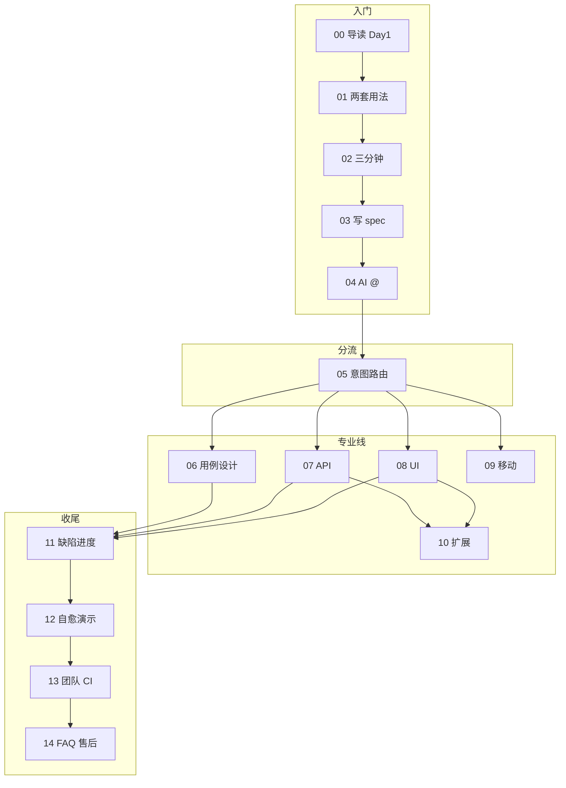

# 高频问题、能力边界与售后说明

系列最后一篇：把使用中最常问的问题收拢一遍，并说明**包能做什么、不能做什么**。已购用户日常可只收藏本篇 + `00-系列导读` 的「按问题查」表。

> **命令与路径**：以你 zip 内 **`README.md`** 为准。

---

## 交付物与售后（已购先看）

| 事项 | 怎么做 |
|------|--------|
| **你手里有什么** | zip 解压后的 `skills-专业版V3.0` 目录 + 本使用手册（`skills3.0使用手册/`） |
| **第一次跑通** | `00` 的 **Day 1** → `02-三分钟跑通.md` → zip 内 `README.md` |
| **演示后端** | `seckill_finance_system`（进销存）**不在 zip 内**；**联系交付方获取**（亦见 `LICENSE.txt`） |
| **版本对应** | 本手册标注 **V3.0**，目录名一般为 `skills-专业版V3.0`；若你收到 V3.0x 等变体，以 zip 内 `STRUCTURE.md`、发行说明为准 |
| **升级新版** | 下载新 zip → 备份你们改过的 spec → 阅读发行说明是否改 schema → 对关键 spec 重新 `./generate.sh` → 可选跑 `python codegen/selftest_bundle.py` |
| **答疑入口** | **以购买凭证为准**（社群 / 邮箱 / 工单）；提问时请附：Python 版本、`generate.sh` 输出或 `output/.last_run_message.txt`、`pytest -v` 片段（脱敏） |
| **学不会时读什么** | ① `README.md` ② `START_HERE.md` ③ 本手册 `01`～`04` ④ `prompts/常用话术.md` |

---

## 基础与安装

**Q1：我不会 Python，能用吗？**  
能。用声明式 spec + `./generate.sh`，不必手写 Python。要改复杂逻辑或读失败栈，会一点 Python 更轻松。

**Q2：必须装 Cursor 吗？**  
不必须。本地 generate 任何编辑器都行。AI 技能包需要支持 `@` 引用文件的编辑器（Cursor、Trae 等）。

**Q3：Windows 怎么跑 `generate.sh`？**  
用 Git Bash / WSL，或：`bash generate.sh templates/api_smoke.md`。

**Q4：解压后找不到 pytest？**  
用 `python3 -m pytest`，并 `pip install pytest requests PyYAML`（完整依赖见 README 表）。

**Q5：终端完全没输出？**  
看 `output/.last_run_message.txt` 和 `output/api_smoke.py` 时间戳；见第 2 篇、`README` 排错节。

**Q6：目录名不是 `skills-专业版V3.0` 怎么办？**  
只要根目录有 `generate.sh` 即可；所有 @ 路径相对该根目录。

---

## 与 ChatGPT / 其他工具

**Q7：和网页版 GPT 写脚本有啥区别？**  
专业版有固定 SKILL 流程、统一缺陷字段、本地 generate 可进 CI，减少每次重讲规矩。见 `01-开篇-两套用法.md`。

**Q8：支持 MidScene / TS Playwright 吗？**  
主交付是 **Python pytest**；不以 MidScene、`.spec.ts` 为准（见第 8 篇）。已有 TS 资产需自行迁移或并行维护。

**Q9：会自动建 Jira 单吗？**  
不会。缺陷是 Markdown 模板，自行粘贴或二次对接 API。

---

## 能力与边界

**Q10：没有 OpenAPI 能做接口自动化吗？**  
能。用接口清单、Postman 导出或自然语言 + `@api-skills/执行`。

**Q11：没有后端能验收吗？**  
能。`pytest --collect-only` 验证生成链；全绿需测试环境或演示后端。

**Q12：演示后端在 zip 里吗？**  
不在。即进销存演示项目 `seckill_finance_system`，**联系交付方获取**。见上文「交付物与售后」。

**Q13：能替代性能团队吗？**  
不能。`perf_test` 适合冒烟级 Locust；容量、稳定性、监控需专业性能工程（见第 10 篇）。

**Q14：视觉回归一定准吗？**  
否。基准图、动态数据会导致误报，要人工判读与更新策略。

**Q15：自我修复一定能修好？**  
否。只收敛脚本/spec 类问题；产品 bug 仍要报缺陷（见第 12 篇）。

**Q16：能把公司 PRD 直接丢给公网 AI 吗？**  
视公司合规而定。请先脱敏；禁止外传时请用企业/本地模型或只用声明式线。见 `04` 隐私节、`00` 导读。

---

## 使用与协作

**Q17：spec 和 pytest 放哪个仓库？**  
建议业务仓库放 spec + 生成脚本；技能包当工具库。见第 13 篇。

**Q18：AI 生成的用例能直接上线吗？**  
建议过 `testcase-skills/评审` 或人工抽检后再执行。

**Q19：术语为什么叫「缺陷」「技能」？**  
全包统一，便于文档、缺陷、进度一致。

**Q20：怎么学最快？**  
`00` Day 1 → `01` → `02` → `03` → `04`，再按岗位看 `06` / `07` / `08`。

**Q21：升级版本要注意什么？**  
见上文「升级新版」；业务 spec 务必重新 generate 做 diff。

---

## 能力边界回顾（帮同事对齐预期）

适合用本包的场景：

- 已用或打算用 **AI 编辑器** 做需求与自动化  
- 需要 **声明式 + SKILL** 双模式，团队产出格式统一  
- 要接口、UI、用例设计、缺陷、进度**一条链**上的约定，而不是零散 prompt  
- 愿意维护 spec / pytest 进 Git 和 CI  

本包**不承诺**替代的能力：

- 一次性脚本、不愿维护 spec 与用例文档  
- 完全不能装 Python、不能跑 Playwright / Appium 的环境  
- 强依赖「必须自动建 Jira、必须 TS 主交付」且不愿改编排  
- 买一个 zip 就替代整个性能与安全团队  

（给同事介绍产品时，可把本节转发。）

---

## 系列回顾

---
